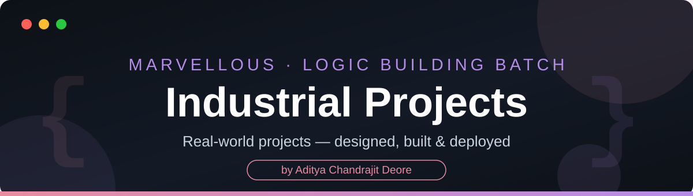

<div align="center">



<br/>


</div>

---

## 📖 About

This repository holds the **industrial projects** built during the **Marvellous Logic Building Batch** — complete, working applications that apply the batch's concepts (C, C++, Java and Data Structures) to real problem statements, the way they would be built for a client: designed first, then implemented, tested, and documented.

Each project gets its own folder at the root of this repository, with its source code and its own README describing the problem, the design, and how to run it.

---

## 🗂️ Structure

```text
Industrial_Projects/
│
├── README.md
├── LICENSE
├── .gitignore
├── assets/                 ← banner & footer artwork used in this README
│
├── Project_Name_1/         ← source + project README
├── Project_Name_2/
└── …
```

Projects are added here as the batch reaches them.

---

## 👨‍💻 Author

<div align="center">

**Aditya Chandrajit Deore**
B.Tech Information Technology — PCCOE, Pune

[](https://github.com/AdityaxDeore)
[](https://www.linkedin.com/in/aditya-deore-3a725a263/)
[](https://adityadeore.vercel.app)
[](https://x.com/AdityaDeore2678)


</div>
